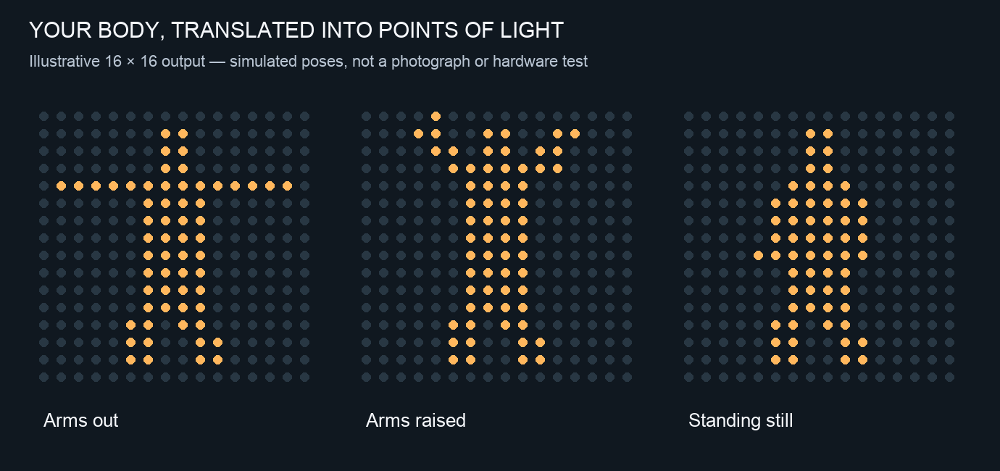
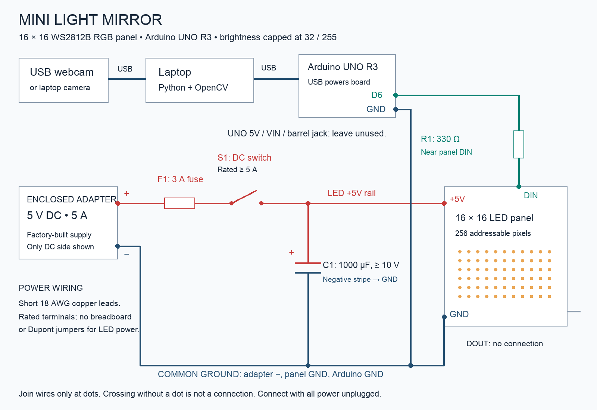

# Mini Light Mirror

A first-year engineering build: your body becomes a moving silhouette made of 256 lights.

**Recommended first build:** a 16 × 16, 5 V WS2812B RGB panel; Arduino UNO R3; an existing laptop; a webcam; and a factory-enclosed 5 V / 5 A DC adapter. Begin with the laptop preview before buying hardware. This guide and code implement one complete, deliberately modest prototype.

## 1. What your reference is doing

The selected scene is consistent with Random International's **Our Future Selves (2019)**. The artist describes a body reflection distributed through points of light and lists ToF sensors, LEDs and custom electronics. ToF means time of flight: a sensor measures how long light takes to travel out and return, allowing distance measurements. The public description does not disclose the complete NMACC installation circuit, sensor arrangement or software.

Our design reproduces the **visible silhouette-following behavior in a flat grid**. It uses a normal webcam and a saved empty background instead of reconstructing the original sensing system. There is no claim that this is the original artist's circuitry or code. Credit the reference in your project report: “Educational prototype inspired by Random International's Our Future Selves.”

The effect is a real-time display, not a physical shadow. The camera observes you; software finds the region you occupy; selected LEDs reproduce that region. Moving your arms changes that region automatically. No pre-programmed list of poses is required.

**Expected result:** a coarse, recognisable body shape, side-to-side movement and large arm gestures. A 16 × 16 display does not reproduce facial features or individual fingers reliably. It cannot show hidden limbs behind your body. A depth camera and a larger display are later upgrades.



Original artist reference: https://www.random-international.com/our-future-selves-2019

## 2. The whole system, in one line

Person → webcam → laptop running Python/OpenCV → USB → Arduino → addressable LED panel.

Two power paths run alongside this data path:

- Laptop USB powers the Arduino.
- A separate 5 V adapter powers the LED panel through a fuse and switch.
- Arduino GND, adapter negative and panel GND connect together. The two positive power rails do **not** connect together.

The camera connects to the laptop, not to the Arduino. An UNO cannot process ordinary webcam video by itself. Its job here is small and dependable: receive a 256-bit image and update the LEDs.

## 3. Components and budget

These are planning ranges in Indian rupees, not quotations. Tools and an existing laptop are excluded. Supplier listings checked on 9 October 2026 showed a 5 V 16 × 16 panel around ₹1,329 and an UNO-compatible board around ₹219; availability and prices can change.

| Item | Quantity / specification | Role | Planning cost |
|---|---|---|---:|
| Laptop | Existing Windows, macOS or Linux laptop | Camera processing, preview and USB output | Borrow / existing |
| Webcam | Built-in camera first; otherwise USB 720p or better | Sees the full body | ₹0 existing; ₹500–1,500 external |
| Arduino UNO R3 | ATmega328P, 5 V logic; compatible board acceptable | Drives the LED data signal | ₹250–600 compatible |
| USB data cable | Matches your UNO connector | Power and serial data | ₹80–200 |
| Addressable RGB LED panel | **16 × 16, 256 pixels, 5 V WS2812B-compatible, DIN/GND/+5V** | Physical light image | ₹1,300–2,000 |
| Enclosed regulated adapter | **5 V DC, 5 A**, protected output | LED power at the specified brightness cap | ₹650–1,000 |
| Series resistor R1 | 330 Ω, ¼ W | Reduces data-line transients | ₹2–10 |
| Electrolytic capacitor C1 | 1,000 µF, at least 10 V | Buffers supply changes close to panel | ₹15–50 |
| Inline fuse and holder F1 | 3 A DC-rated fuse | Protects the wiring against faults | ₹50–150 |
| Low-voltage switch S1 | At least 5 A DC at 5 V | Disconnects LED positive supply | ₹30–100 |
| DC socket / adapter connector | Correct plug dimensions/polarity; ≥5 A rated | Secure adapter connection | Part of wiring allowance |
| Wiring, rated terminals, heat shrink | Short 18 AWG copper power leads; signal wire | Reliable connections | ₹150–350 |
| Rigid backing, standoffs, diffuser, frame | Buy after confirming actual panel dimensions | Finish and mechanical support | ₹300–800 |

Aim for roughly **₹3,000–5,500 with an existing camera and laptop**; allow more for an external camera, tools or an official Arduino. A smaller budget can still prove the whole tracking idea using the laptop-only preview.

Borrow a multimeter, soldering iron, solder, cutter and wire stripper from your lab. Ask a lab technician to check the first power wiring. An inexpensive breadboard is useful for learning circuits but is not suitable for this panel's power distribution.

**Check before ordering:** 5 V rather than 12 V; individually addressable LEDs rather than ordinary RGB strip; a WS2812B-compatible interface rather than HUB75; RGB rather than RGBW; accessible power connections; matching adapter connector; and real panel dimensions. Flexible panels need a rigid, insulated backing.

Reference listings:

- Panel: https://robu.in/product/ws2812-rgb-flexible-16x16-leds-pixel-panel-matrix-screen-led-module-5v/
- Listing category with panel price: https://robu.in/product-category/rgb-led-strip/
- UNO compatible: https://robu.in/product/arduino-uno-r3-ch340g-atmega328p-devlopment-board/
- Example enclosed adapter: https://robu.in/product/pro-range-5v-5a-power-adapter/

## 4. What the unfamiliar parts mean

**Microcontroller:** a small computer that runs one embedded program. Here, that is the UNO.

**Addressable LED:** each light has an internal driver and its own position in a data chain. One data wire can set hundreds of different pixel colours. The panel already contains these drivers; you do not need 256 Arduino output pins or 256 external switching transistors.

**DIN and DOUT:** data enters through DIN and can continue to another panel through DOUT. These are directional. Power can enter the marked power pads; the data signal must enter DIN.

**Ground:** the shared zero-volt reference that allows the Arduino's data voltage to make sense to the LEDs.

**Resistor:** R1 is in series with the data wire. It is not a power resistor for the whole LED panel and does not limit the panel's supply current.

**Capacitor:** C1 is across the power rails, in parallel with the panel. Its positive lead goes to +5 V and its striped negative side goes to GND. Reversing an electrolytic capacitor can damage it.

**Frame:** one complete image. A new frame changes which LEDs are lit. **FPS** is frames per second; the program targets 25, though actual performance depends on your laptop and camera.

**Mask:** a black-and-white image. White means foreground, black means background. It says where the person is, not who the person is.

## 5. Wiring diagram and exact connections

Open `wiring.png` for the readable diagram or `wiring.svg` for scalable printing. Symbols show electrical connections, not the exact physical positions of your panel's connectors. Read the labels printed on your own board; do not trust connector wire colours alone.



| From | To | Detail |
|---|---|---|
| Laptop USB | UNO USB socket | Use a data-capable cable |
| External webcam USB | Laptop USB | Skip if using the built-in camera |
| UNO digital pin **D6** | One end of R1, 330 Ω | Data wire, preferably under 30 cm |
| Other end of R1 | Panel **DIN** | Put R1 close to DIN |
| Adapter +5 V | F1 input | Check DC polarity with a meter |
| F1 output | S1 input | 3 A fuse close to supply connector |
| S1 output | Panel +5 V | Short power lead and rated terminal |
| Adapter negative | Panel GND | Direct power return |
| UNO GND | Same common ground | Signal reference; do not route LED load current through UNO |
| C1 positive | Panel +5 V, after switch/fuse | Near panel power input |
| C1 negative / striped side | Panel GND | Parallel capacitor |
| Panel DOUT | Nothing | Insulate unused lead |
| UNO 5V, VIN, barrel socket | Nothing | They are unused in this design |

Use short, secure 18 AWG copper power leads. Thin Dupont jumpers may carry the data signal and Arduino ground reference; do not use them or breadboard rails for the LED power path. Use insulated terminals rated for the available current. If the panel has dedicated heavier power wires, use those as the seller specifies.

If distant pixels dim or change colour under load, connect a second short +5 V/GND feed from the **same fused supply** to marked power pads at the far side. Verify polarity and connector ratings first. Do not parallel two adapters. Keep all power disconnected while changing wiring.

An UNO uses 5 V logic, so this short connection does not require a level shifter. An ESP32 uses 3.3 V logic and would require a different design, typically with a suitable 5 V logic buffer. It is not a drop-in substitution for the wiring here.

## 6. Power: understand this before switching on

LED count is 16 × 16 = 256. For conservative planning, a conventional RGB NeoPixel may use up to about 60 mA at full white. Actual LED variants differ; use the purchased panel's specifications if they are higher.

At unrestricted full white, the estimate is 256 × 0.060 A = **15.36 A**, or approximately 77 W at 5 V. **A 5 V / 5 A adapter cannot support that.**

The supplied firmware fixes brightness to **32 out of 255**, about 12.5%. At that setting, the estimated full-white LED-channel load is 15.36 × 32 / 255 ≈ **1.93 A**. Allow additional current for pixel electronics and tolerances. The warm display colour normally draws less. Use the 5 A adapter and 3 A fuse only with this capped prototype, and measure the real load before extended operation.

This is an engineering estimate, not an active current measurement. Brightness control is not a replacement for the fuse. A compile-time check in the sketch prevents casually raising the brightness constant above 32; removing that check changes the design. Do not upload unrestricted full-brightness example animations to this wiring. If a fuse blows, diagnose the problem rather than fitting a larger fuse.

The adapter's current rating is its capacity; it does not force 5 A into the lights. Voltage must match. A 12 V adapter can destroy a 5 V panel.

Use a factory-enclosed adapter, not an open mains-terminal supply. All student wiring in this build is on the low-voltage DC side. Mount the panel on an insulated backing and prevent exposed conductors from touching.

Power on: connect and verify everything with power unplugged, switch on LED power, then connect UNO USB/start the program. Power off: quit the program, disconnect UNO USB, then switch off LED power. This avoids driving data into an unpowered panel.

Adafruit's circuit recommendations: https://learn.adafruit.com/adafruit-neopixel-uberguide/best-practices

Adafruit's explanation of current estimates and their limits: https://learn.adafruit.com/sipping-power-with-neopixels?view=all

## 7. How the camera processing works

1. Save an image of the scene with nobody in the camera view.
2. Read the live camera image.
3. Compare its colour values to the saved image.
4. Mark sufficiently different pixels as foreground.
5. Remove isolated speckles and close small gaps.
6. Divide the mask into 16 × 16 cells.
7. Turn on an LED when foreground covers roughly 20% or more of its cell.
8. Repeat.

For a pixel, the basic decision is `max(abs(current_RGB - background_RGB)) > threshold`. The implementation uses OpenCV's unsigned-safe `absdiff`, avoiding byte underflow. Threshold is initially 35 on a 0–255 scale and can be adjusted using the on-screen slider.

**Why you remain visible when you stand still:** the stored background stays fixed. This is different from comparing each frame with the previous one, which mainly detects movement, or continually learning the person into an adaptive background model. Only pressing B replaces the saved background.

**Limits:** changing lights, shadows, moving curtains and changes in camera exposure can also count as foreground. Clothing too similar to the background may disappear. This simple algorithm does not semantically recognise people or understand a gesture's meaning. A plain background, stable lighting and a fixed camera make the first version practical. For a crowded or changing environment, use person segmentation or depth sensing later.

OpenCV explains the processing operations here:

- Thresholding: https://docs.opencv.org/4.x/d7/d4d/tutorial_py_thresholding.html
- Morphology: https://docs.opencv.org/4.x/d9/d61/tutorial_py_morphological_ops.html

## 8. Software files and installation

| File | Runs on / purpose |
|---|---|
| `silhouette.py` | Laptop: camera, calibration, mask, preview and USB sending |
| `protocol.py` | Laptop: packs 256 pixels into 32 bytes and calculates error check |
| `light_mirror/light_mirror.ino` | UNO: receives frames and controls LEDs |
| `requirements.txt` | Laptop package list |
| `test_protocol.py` | Dependency-free data-protocol checks |

Install Python **3.11 or 3.12** and Arduino IDE 2 from their official sites. These are conservative Python choices for package compatibility. Keep all the downloaded files together. Open a terminal in the folder containing `silhouette.py` and `requirements.txt`.

**Windows:**

```powershell
py -3 -m venv .venv
.venv\Scripts\python.exe -m pip install -r requirements.txt
.venv\Scripts\python.exe silhouette.py
```

**macOS / Linux:**

```bash
python3 -m venv .venv
.venv/bin/python -m pip install -r requirements.txt
.venv/bin/python silhouette.py
```

The remaining commands below use `python` as shorthand for your environment's Python executable. You may continue using the full `.venv` path above. Install `opencv-python`, not `opencv-python-headless`, because the application needs graphical windows.

No internet is used by the supplied program after installation. It processes frames locally, does not record video, and does not upload camera images. Allow camera access to the Python application or terminal if your operating system requests it.

**First laptop-only run:**

1. Keep the camera fixed. The preview shows a centred square crop; put your entire body and both outstretched arms inside that crop.
2. Let camera exposure settle for several seconds.
3. Press **B** with the preview window focused.
4. You have three seconds to step out; stay out while 30 empty-scene frames are averaged.
5. Step back into view. You should see the camera image, a white foreground mask and a simulated LED panel.
6. Raise both arms, turn sideways and stand still. Check that the silhouette stays visible.
7. Use the threshold slider: increase it to reject noise; decrease it if parts of the body are missing.
8. Press **Q** or Escape to quit. If the camera moves or lighting changes, capture a new empty background with B.

If the wrong camera opens, try `python silhouette.py --camera 1`. A built-in webcam is enough for the first experiment; an external one makes final positioning easier.

## 9. Upload the UNO program

1. Before connecting LED power/data, use the Arduino IDE's Blink example to verify that your UNO and USB cable work.
2. Open `light_mirror/light_mirror.ino`. The sketch folder and file deliberately have the same name.
3. In Library Manager, install **Adafruit NeoPixel** by Adafruit.
4. Select **Arduino Uno** under the Arduino AVR Boards platform, and choose the actual port.
5. Upload the sketch. Keep `BRIGHTNESS = 32` unchanged.
6. Close Arduino Serial Monitor and Serial Plotter before starting Python: two applications cannot normally use the same port simultaneously.

Find the port from your Python environment:

```bash
python -m serial.tools.list_ports
```

Windows ports commonly look like `COM5`; macOS ports like `/dev/cu.usbmodem1101` or `/dev/cu.usbserial-...`; Linux ports like `/dev/ttyACM0`. These are examples. Use the actual result, not a guessed port. Some compatible boards require the manufacturer's USB-serial driver.

Official resources:

- UNO documentation: https://docs.arduino.cc/hardware/uno-rev3/
- Arduino IDE: https://www.arduino.cc/en/software/
- NeoPixel library: https://github.com/adafruit/Adafruit_NeoPixel
- Python: https://www.python.org/downloads/
- pySerial usage: https://pyserial.readthedocs.io/en/latest/shortintro.html

## 10. Test the LEDs before connecting the camera logic

Complete the circuit, check polarity and shorts with power off, and follow the power-up sequence above.

First run a corner test, substituting your port:

```bash
python silhouette.py --port COM5 --test-pattern corners
```

One LED should light in this repeating order: **top-left → top-right → bottom-right → bottom-left**. Each corner lasts about one second. This mode needs no camera.

Then run:

```bash
python silhouette.py --port COM5 --test-pattern scan
```

The dot should move left-to-right across the top row, then left-to-right across the second row, and so on. A full scan takes about 25.6 seconds. If the preview is correct but the physical panel is not, fix the firmware's mapping settings, not the vision threshold.

The default panel map starts at the upper left and snakes across alternating rows. In the firmware:

- `SERPENTINE`: true for alternating physical row direction, false for the same direction every row.
- `SWAP_XY`: transpose coordinates, useful for column-wired panels.
- `FLIP_X` / `FLIP_Y`: reverse horizontal / vertical orientation.

Panel layouts vary. Change one setting at a time, re-upload and repeat the corner/scan checks. These settings cover ordinary row/column and snake layouts; an unusual tiled panel can require a custom `physicalIndex()` function.

For the default map, logical `(x, y)` becomes `y * 16 + x` on even rows and `y * 16 + (15 - x)` on odd rows. Thus the second row's physical numbers decrease as the visible image moves right.

Finally test all pixels with the supplied capped firmware:

```bash
python silhouette.py --port COM5 --test-pattern full
```

This is full **pixel occupancy**, not unrestricted full brightness. Initially test briefly. Check the supply stays near 5 V at the panel under load; look for resets, flicker, dim far-side pixels, or warming connectors. Measure current with a suitably rated meter **in series**, or use a rated inline DC meter. Never put a meter in current mode directly across the supply. If you have not used a multimeter in current mode, ask your lab technician to perform that measurement.

## 11. Run the complete mirror

```bash
python silhouette.py --port COM5
```

For example on macOS:

```bash
python silhouette.py --port /dev/cu.usbmodem1101
```

Capture the empty background with B, then step into frame. The software mirrors the camera horizontally, like a normal mirror; use `--no-mirror` if you want an unmirrored view.

Only 35 bytes are sent per frame: a two-byte header, 32 bytes for 256 on/off pixels and one CRC byte. At 25 FPS, that is about 875 data bytes per second before serial start/stop bits. The UNO does not need to receive the full webcam image.

The Arduino returns an acknowledgement after updating the LEDs. Python waits for it before sending another frame, avoiding lost serial bytes while the LED library temporarily disables interrupts. Bad checksums are rejected. If frames stop arriving, the firmware blanks the LEDs after roughly two seconds. Quitting normally also sends a blank frame.

Code and protocol have been reviewed; Python syntax and dependency-free protocol tests are checked in this package. The authoring environment did not have OpenCV or a connected camera/UNO/panel, so camera behavior, Arduino compilation, real current, timing and the complete physical build remain to be verified on your equipment. The staged tests above are part of the build, not optional assumptions about success.

## 12. Physical placement and finish

Mount the display vertically with the camera near its centreline, facing the participant. Do not aim the camera at the LED panel: that creates feedback. Use a stable camera support and mark a participant area on the floor. Start around two to three metres away, then adjust until the full body and raised arms fit inside the square preview; actual distance depends on lens field of view.

Keep the person and background evenly lit. Dim the area around the LEDs for contrast, while maintaining enough steady light for the webcam. A completely dark room makes a normal webcam perform poorly. Avoid windows with changing sunlight, moving fans or curtains in view, and strong shadows. Lock exposure and white balance in the camera's own controls if supported.

Mount the flexible panel to a rigid insulated board with spacers. Add a black frame to improve contrast. A thin frosted diffuser can soften the LEDs; try a small sample first, because excessive diffusion merges neighbouring pixels. Keep enough ventilation and access to the DC switch and fuse. Cover exposed solder joints and provide strain relief where cables enter the frame.

A ready-made 16 × 16 panel is often around 16 cm square, but pitches differ: order the frame only after confirming actual dimensions. This is a tabletop/wall proof of concept.

For a larger physical light wall without changing logical resolution, build the same 256-pixel grid from individual addressable pixels or short strips on a 40–60 cm frame. That requires additional soldering, supports, signal routing and distributed power feeds. The existing panel is the simpler first milestone. LED count controls resolution; physical spacing controls display size. Making a 16 × 16 grid larger does not add detail.

## 13. Troubleshooting

| Symptom | Likely cause | First check |
|---|---|---|
| No camera image | Permission, wrong index or camera in use | Close other camera apps; check permissions; try `--camera 1` |
| Whole mask turns white | Background captured incorrectly or lighting/exposure changed | Step out and press B again after exposure settles |
| Body partially disappears | Low contrast against background, threshold too high | Contrasting clothing/background; lower threshold |
| Shadow follows you as a second shape | Background subtraction also sees shadows | Softer frontal light; greater distance from wall |
| No silhouette after standing still | Incorrect calibration, or different code/model being used | Confirm this fixed-background script; don't capture B while standing in view |
| LEDs remain dark | Wrong DIN, no LED supply, no shared GND or wrong port | Run corner test; meter panel +5V/GND |
| Python reports no acknowledgement | Wrong firmware/port, another app owns port, cable issue | Close Serial Monitor, upload sketch, restart Python |
| Alternate rows backwards | Panel scan order differs | Change `SERPENTINE` and run scan test |
| Display rotated or flipped | Physical coordinate mapping | Corner test and SWAP_XY/FLIP settings |
| Wrong LED colours | Different RGB byte order | Check panel specification; change `NEO_GRB` appropriately |
| Flicker or resets | Weak/long power wiring, voltage drop, loose ground | Shorten power leads and measure loaded voltage |
| Jerky motion | Slow camera/processing or weak USB connection | Start at `--fps 15`; check camera and cables |
| Fuse opens | Short, polarity error or unexpected load | Disconnect, inspect, measure; do not fit a bigger fuse blindly |

## 14. Build it as five small projects

**Milestone A — Camera:** laptop-only preview captures a usable background and preserves a held pose for at least 30 seconds.

**Milestone B — Controller:** UNO Blink uploads successfully. The supplied sketch compiles and uploads with the correct library.

**Milestone C — Power and one dot:** correct measured voltage, secure wiring, correct corner sequence and no unexpected heating.

**Milestone D — Full mapping:** scan test reaches every location in order. Full-occupancy capped test has stable power. Run a supervised 10–15 minute soak test after initial checks.

**Milestone E — Integration:** camera silhouette matches the physical panel during left/right movement, arms up, arms out, sideways stance, held still pose and leaving the frame. Unplug USB and check that the display blanks. Record measured FPS/current and conditions for your report.

A team of three or four can divide work into vision software, circuit/power testing, frame/finish and integration/documentation. Allow roughly one to two weeks of lab sessions if these tools are new to you; component delivery and debugging can dominate the schedule.

## 15. Upgrades after the first working version

| Upgrade | What it improves | What changes |
|---|---|---|
| 16 × 32 or 32 × 32 display | Body proportions/detail | RAM, protocol, wiring, power and mapping; UNO firmware is not a drop-in 32 × 32 solution |
| Person-segmentation model | Separates people from many background changes | Laptop software/model; choose a model that suits your lighting and multi-person needs |
| Depth camera | Selects people by distance; can reduce dependence on visible contrast | Sensor, SDK, calibration and budget; ToF/IR also has environmental limits |
| Light trails | Short-lived echoes of previous poses | Maintain and fade past masks; optional artistic delay |
| Motion-dependent colour | Fast movement changes colour | Add a motion metric and colour controls while retaining power caps |
| Vertical hanging pixels | Appearance closer to a light curtain | Mechanical suspension, distributed power and revised LED map |
| Embedded computer | Eliminates a full laptop | Replace laptop with a suitable computer; UNO still only handles LEDs |

Do not buy one ordinary PIR sensor or one HC-SR04 ultrasonic sensor expecting a body silhouette. Those sensors lack the spatial image needed to distinguish the head, arms and legs. Likewise, merely making a shape appear on a monitor is the software milestone, not the completed physical installation.

For a project presentation, demonstrate the three intermediate views: camera → mask → LED grid. Explain why a fixed background preserves a held pose, why the common ground matters, and why the LEDs need their own supply. Those choices show that you understand the system rather than only running borrowed code.

## 16. Verification supplied with this package

Run `python test_protocol.py` to check the standard CRC vector, all 256 individual pixel bit positions, 1,000 random frame round trips, single-bit corruption detection and invalid frame lengths. These tests validate encoding, not camera segmentation or physical wiring.

Run `python -m py_compile silhouette.py protocol.py test_protocol.py` for a Python syntax check. Actual imports require the packages above. Use Arduino IDE's Verify button to compile for your UNO before uploading.
