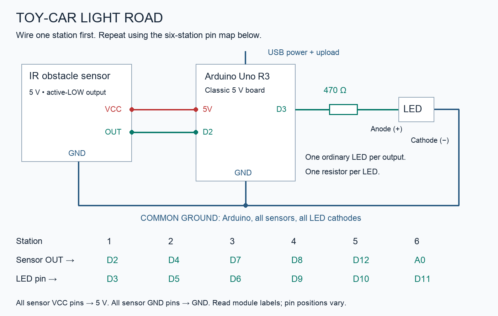

> Alternative checkpoint demonstration: this does not provide continuous position or silhouette tracking. For the current project direction, start at the root README and interactive preview.

# Toy-car light road — six zones, existing Arduino, under ₹1,000 target

Push a Hot Wheels car along a cardboard road. At each of six detection stations, one ordinary LED lights. When the car leaves that station, its light stays bright for 150 ms and fades over 450 ms. Park the car at a station and that light stays on. Travel either direction; the program responds independently at every station.

This detects position at six stations. It does not reproduce the car's outline or sense continuously between stations. Arrange the LEDs on a separate upright six-column panel if you want a light display that copies the car's position, closer to the original art reference. The same circuit and code work for either arrangement.

## Parts and budget

Assume an existing classic 5 V Arduino Uno R3 or Nano, USB cable, and USB power source. The exact pin map is for those boards. Do not apply this 5 V wiring unchanged to a 3.3 V board.

| Part | Quantity | Planning allowance |
|---|---:|---:|
| 5 V, three-pin IR obstacle modules, active LOW, adjustable sensitivity | 6 | ₹150–300 |
| Ordinary high-brightness 5 mm LEDs, any one colour | 6 | ₹15–30 |
| 470 Ω, ¼ W resistors | 6, one per LED | ₹5–15 |
| Small breadboard or suitable perfboard | 1 | ₹60–100 |
| Jumper wires / hookup wire | As needed | ₹60–100 |
| Reused cardboard, tape/glue, paper diffusers | As needed | ₹20–60 |
| Existing toy car, USB cable and Arduino | Existing | ₹0 |

Plan around ₹400–750 including a modest shipping allowance; leave the remainder of your ₹1,000 budget for replacements or extra wiring. These are estimates, not a checkout quote. A retailer listing accessed on 9 October 2026 showed the basic active-LOW module around ₹22; local and online prices vary. Buy basic modules rather than premium branded ones for this budget.

Borrow a soldering iron and multimeter if needed. No webcam, addressable LED matrix, motor, motor driver, separate 5 A adapter or Raspberry Pi is required. The car is pushed by hand. A laptop is only needed to upload the Arduino program; the finished demo runs from USB power.

Module listing: https://robu.in/product/ir-infrared-obstacle-avoidance-sensor-module/

## Why the sensor detects a car

Each module contains an infrared emitter and receiver. Reflected light from an object changes its digital output. Buy the three-pin active-LOW type: OUT reads LOW when it detects the object. The blue trimmer adjusts its switching threshold; the module does not return a precise distance measurement. Read the printed VCC/GND/OUT labels—physical pin order varies.

Car colour, reflective surfaces, ambient sunlight and nearby emitters affect detection. The small sensor indicator is useful during calibration. Use the actual car during setup; a hand or white paper can reflect much more strongly than a dark car. A small removable white-paper patch on the car's side can improve consistency.

Manufacturer explanation of the optical principle and environmental limits (not a recommendation to buy the more expensive board): https://www.waveshare.com/wiki/Infrared_Proximity_Sensor

## Mechanical layout

Use an approximately 60 × 15 cm cardboard base with an 8 cm wide road. Put six sensors along one side, about 8 cm apart, pointing across the road at the car's body. Adjust height so they see the side of the car rather than looking over it. Begin with a 2–4 cm gap from sensor face to car; calibrate experimentally.

Keep all sensors facing in the same direction rather than facing one another. If interference occurs, reduce sensitivity, increase station spacing or add opaque partitions. Visible black material is not always opaque to infrared, so verify the result instead of relying on colour alone. Keep sensors out of direct sunlight and do not cover their emitter/receiver windows with decorative paper.

Start by taping parts temporarily. Glue them only after calibration. Put each LED alongside its matching station, inside a paper streetlight, or behind one of six separate translucent windows on an upright display. The latter gives a miniature light-mirror effect. Each window needs its own LED and resistor; more bulbs per zone require a redesigned driver circuit.

## Connections

Power the Arduino through its USB socket. Connect its 5 V pin to the breadboard positive rail and GND to the ground rail. All six sensor VCC pins connect to the positive rail; all sensor GND pins connect to the ground rail. Breadboard rails are sometimes split halfway—check continuity.

| Station | Sensor OUT to Arduino | LED output pin |
|---|---|---|
| 1 | D2 | D3 |
| 2 | D4 | D5 |
| 3 | D7 | D6 |
| 4 | D8 | D9 |
| 5 | D12 | D10 |
| 6 | A0, used as a digital input | D11 |

For every LED: Arduino LED output pin → 470 Ω resistor → LED anode (+) → LED cathode (−) → GND. The longer uncut lead is normally the anode; the flat case edge usually identifies the cathode. Each LED needs a separate resistor. These are ordinary LEDs, not WS2812 pixels.

For the sensor at station 1: VCC → 5 V; GND → GND; OUT → D2. Repeat with the table for other stations. Only the sensor output is connected to the input pin; do not power a sensor from a GPIO pin.

At 5 V with a red LED near 2 V, current is approximately (5 − 2) / 470 = 6.4 mA per LED. All six together use around 38 mA at maximum brightness. This is appropriate for direct Arduino outputs at these currents; motors and LED strips would need driver circuitry.

With typical IR modules near 20 mA each, the sensors use roughly 120 mA, plus LEDs and the Arduino. Expect an overall load of a few hundred milliamps, and check your actual modules. Keep the total below the board's USB-path rating (the Uno R3 has a nominal 500 mA USB polyfuse). A larger charger does not raise the board's current limit. Use one USB source; do not add a separate 5 V feed at the same time. Some power banks turn off automatically at light loads; a normal USB wall adapter is often easier for the demonstration. Avoid a rectangular 9 V battery.

## Program and first test

1. Wire only station 1 initially: one sensor, one resistor and one LED.
2. Open `toy_car_light_road/toy_car_light_road.ino` in Arduino IDE.
3. Select your correct board and port. Verify, then upload. No additional libraries are required.
4. Push the car in front of the sensor; slowly adjust its trimmer until detection is off for an empty road and on for the car.
5. Confirm the external LED follows the sensor. It should remain on while the car is present, then fade when the car leaves.
6. Add the other five stations individually. Unconnected sensor inputs use internal pull-ups, so unused stations remain off during the initial test.
7. Recheck all six after they are powered together, since optical interference may only appear then.

The supplied code assumes active-LOW modules. If the behaviour is inverted, confirm the module's output convention; a high-active module needs a corresponding code change. Do not compensate for incorrect VCC/GND wiring in software.

## Two display modes

- `TRAIL = true`: light while the object is present, then hold for 150 ms and fade for 450 ms. This is the default visual effect.
- `TRAIL = false`: light only while that station detects the car. Useful for calibration and a direct position display.

You can change `HOLD_MS` and `FADE_MS`; keep `FADE_MS` greater than zero. The program reads all six sensors continuously and uses elapsed time rather than long delays, so fading one LED does not prevent it detecting a car at another station. PWM changes brightness by rapidly switching the LED on and off; the chosen output pins support PWM on classic Uno/Nano boards.

Push the car slowly at first. With 8 cm station spacing and a speed near 20 cm/s, station crossings occur roughly 0.4 seconds apart, giving a noticeable overlapping light trail. Sensing gaps between stations remain real; the trail is a display effect, not additional position measurement.

## Troubleshooting

| Problem | Check |
|---|---|
| Light stays on with an empty track | Reduce sensitivity; remove a nearby wall/hand from view; check active-LOW convention |
| Dark car does not trigger | Lower sensor height, reduce gap, adjust sensitivity or add removable white paper |
| Sensor indicator works but external LED does not | LED polarity, resistor, output pin and ground connection |
| Several unrelated zones trigger | Sensitivity, sensor alignment, sunlight and emitter interference |
| LEDs flicker or Arduino resets | USB cable, loose rails, shorts and actual current draw |
| Car crosses a station without visible effect | Slow it down and align the sensing region with the car body |

## Other builds from the same parts

1. **Position-copy wall:** mount the six LEDs on an upright panel separate from the track. Each lights when the car reaches the corresponding station. The provided code works unchanged.
2. **Six-bay parking garage:** put one sensor in each bay, set `TRAIL = false`, and illuminate occupied bays. The code works unchanged.
3. **White-ball light chute:** a gently sloped narrow track carries a white ball past the six sensors. Realign sensor height and calibrate; the code works unchanged.
4. **Light-following wand:** move a white-tipped stick past the sensing stations, with the sensor faces close to the intended path. The code works unchanged.
5. **Lap counter or speed timing:** reuse two stations as checkpoints; requires different code, defined travel direction and proper event detection. Leave this until the light road works.

For your report, measure the reliable sensor range for a dark car, the same car with white tape, and a white ball. Record false triggers under indoor light versus near a window. You can explain sensing, digital inputs, current limiting, PWM, nonblocking timing and calibration from one inexpensive model.

This is a proposed circuit and sketch, not a physically tested assembly. Verify compilation in Arduino IDE and test one station before building all six.
